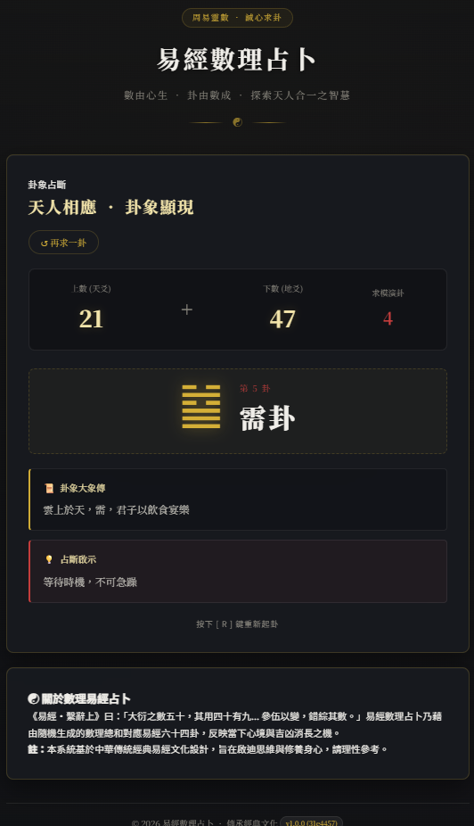

# VibeCodingDivinationByNumbers

Vibe Coding Divination By Numbers  


[PRD](PRD.md)

# PYTHON 🎯 核心功能（已完成）
隨機數字生成 - 生成兩個 1-100 的隨機數字  
易經占卜解讀 - 根據數字總和模 64 對應易經六十四卦  
前端網頁介面 - 美觀的響應式設計，支援各種設備  
AJAX 互動 - 無需刷新頁面的即時占卜體驗  
# 📁 專案結構
VibeCodingDivinationByNumbers/  
├── app.py                 # Flask 後端應用  
├── requirements.txt       # Python 依賴套件  
├── 運行說明.md           # 使用說明文件  
├── templates/  
│   └── index.html        # 前端 HTML 模板  
└── static/  
    ├── style.css         # CSS 樣式文件  
    └── script.js         # JavaScript 功能文件  

# 🚀 技術特點
後端：Flask 框架，包含完整的易經六十四卦資料  
前端：響應式設計，流暢動畫效果，支援鍵盤快捷鍵  
API：RESTful 設計（包含 `/api/version` 版本與 Commit 查詢端點）  
版本：自動整合語意化版本與 Git Short Commit Hash（顯示於頁尾與 API）  
體驗：載入動畫、數字動畫、淡入效果等  
# 💻 快速啟動與使用方式

### 1. 啟動伺服器
建議直接使用專案內建之 Python 虛擬環境執行：

```powershell
# Windows PowerShell (推薦)
.\.venv\Scripts\python.exe app.py

# 或先啟動虛擬環境再執行
.\.venv\Scripts\Activate.ps1
python app.py
```

### 2. 開啟網頁
伺服器啟動後，會在終端機輸出監聽網址（例如：`Server starting on: http://127.0.0.1:5001`）：

- **瀏覽器手動存取**：開啟瀏覽器並輸入 [http://127.0.0.1:5001](http://127.0.0.1:5001) 或 [http://localhost:5001](http://localhost:5001)
- **PowerShell 一鍵開啟**：
  ```powershell
  Start-Process "http://127.0.0.1:5001"
  ```

> [!IMPORTANT]
> **連接埠（Port）變化規則與機制說明**：<br>
> 1. **自動搜尋順序**：系統預設優先嘗試 **5001**。若該 Port 無法綁定，程式會自動依序嘗試 **5002 ~ 5050**，直到找到第一個可用的 Port；若皆無法使用，則交由作業系統隨機分配。
> 2. **常見順延原因（為什麼 Port 會不是 5001？）**：
>    - **Port 已被其他行程佔用**（例如重複啟動了 `app.py` 或其他本地服務）。
>    - **Windows 系統保留區間**：在啟用 WSL、Hyper-V 或 Docker 的 Windows 環境下，WinNAT 常會動態保留部分 TCP 區段（如常見的 `4904 ~ 5003`）。此時 5001~5003 會因系統限制無法綁定，程式會自動順延至 **5004** 或其後的第一個可用連接埠。
> 3. **確認當前網址**：每次啟動時，終端機皆會印出當前成功綁定的網址：`Server starting on: http://127.0.0.1:XXXX`，請以終端機顯示之實際網址為準。
> 4. **強制指定固定 Port**：若欲指定特定 Port，可透過環境變數啟動：
>    ```powershell
>    $env:PORT=5001; .\.venv\Scripts\python.exe app.py
>    ```

### 3. 操作步驟
1. 點擊畫面上的「**開始占卜**」按鈕（或按鍵盤 **空格鍵**）
2. 系統將隨機產生兩個數字並轉換為對應的易經卦象
3. 閱讀卦名、卦象與詳細解讀結果
4. 點擊「**重新占卜**」（或按鍵盤 **R 鍵**）可進行下一次占卜

# 響應式設計
支援桌面、平板、手機等各種設備  
優雅的漸層背景和卡片式設計  
觸摸設備優化  
